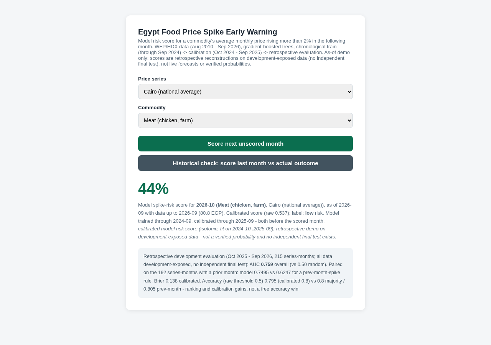

# Egypt Food Price Spike Early Warning

End-to-end machine learning project: a classifier that estimates the
probability that a food commodity's average monthly price in Egypt will
rise more than 2% in the next month, trained on WFP food price data and
served through a FastAPI web app.



## Why this task

A first attempt at plain next-month price *regression* on this data found
that a persistence baseline ("next month = this month") is essentially
impossible to beat - Egyptian monthly food prices are smooth with step
jumps. Rather than ship a model that loses to its baseline, the project
reframes the problem as the question machine learning actually answers
better here: **is a price jump coming?** The classifier beats both the
majority-class and previous-month baselines on a strict time holdout.

## Results

**Protocol.** Chronological windows with every fitting date strictly before
every served date: train < Oct 2024, isotonic calibration on Oct 2024 -
Sep 2025, retrospective evaluation on Oct 2025 - Sep 2026. The pipeline
(model, features, 2% spike definition, 0.5 threshold) was frozen before the
evaluation run. This is a retrospective development evaluation: the window
was reproduced and reused across versions, so it is not an untouched
one-shot final test.

**Retrospective evaluation (Oct 2025 - Sep 2026, 215 series-months):**

| Metric | Model | Baseline |
|---|---|---|
| ROC AUC | **0.759** (all 215) | 0.500 (random). Paired on the 192 series-months with a prior month: model 0.750 vs 0.625 (previous month spiked) |
| Brier (raw / calibrated) | 0.141 / **0.138** | - |
| Accuracy (raw threshold 0.5) | 0.795 | 0.800 (majority) / 0.805 (previous month spiked) |
| Accuracy (calibrated threshold 0.5) | 0.800 | same baselines |
| F1 (spike class, raw threshold 0.5) | 0.353 | - |

Reading: the model carries real ranking signal - paired on the 192 scored
months with a prior month, model AUC 0.750 vs 0.625 for a prev-month-spike
rule - and calibration measurably improves its scores. At a 0.5 threshold its accuracy does NOT
beat trivial baselines on this window - reported as-is; the app presents a
calibrated risk score with baselines shown, not an accuracy claim.

**v4 model change (2026-11-04).** The classifier is now
HistGradientBoostingClassifier(max_iter=200, learning_rate=0.03,
l2_regularization=1.0, max_leaf_nodes=15), replacing the v3
(max_iter=600) model. The variant was selected on rolling origins
2016-2022 ONLY (mean AUC .637 -> .664, min AUC .511 -> .529, mean
calibrated Brier .2391 -> .2218); the 2024-10 origin above was excluded
from selection. All origins are development-exposed data, not a holdout.
v4 leads v3 on 3 of 4 selection origins and trails on 2016; on no origin
does it beat the previous-month heuristic on accuracy. Full tables,
protocol freeze and negative findings: `ROBUSTNESS.md`,
`PROTOCOL_FREEZE.md`, `rolling_origin_eval.json`, `baseline_compare.json`.

**Honesty boundary.** The entire dataset was exposed during development
(task framing, model class, features and hyperparameters were chosen after
exploratory scoring of several windows). These numbers are a RETROSPECTIVE
evaluation of a frozen pipeline - there is no independent final test on
this dataset, and none is claimed. Full numbers and the protocol in
`models/metrics.json`; curves in `figures/roc_pr_curves.png` and
`figures/calibration_curve.png`.

## How leakage is prevented

- Features for a target month use only observations strictly before it.
- Lags are calendar-exact: `price_lag_k` is the price exactly k months
  earlier and `NaN` when that month was not observed (the Cairo series has
  gaps) - never a row-shift that smuggles future information across a gap.
- Chronological windows (train < 2024-10, calibrate 2024-10..2025-09,
  evaluate >= 2025-10), identical cutoffs for every series.
- The calibrator is fit only on the calibration window, on a model trained
  only on the training window - no future-to-past calibration.
- As-of serving rule: the app refuses to score months inside the training
  or calibration windows (before 2025-10) because those scores would be
  in-sample; every served score has all fit/calibration dates strictly
  before the scored month (asserted by tests).
- `tests/test_features.py` proves the no-leakage property: changing a
  month's price leaves that same month's features unchanged.
- `tests/test_split.py` proves the chronological windows are disjoint and
  global, that the artifact's train/calibration max dates strictly precede
  every servable date, that app prediction rows align with the exact
  preceding calendar months' real prices, and that in-sample history
  checks are refused.

## Project structure

```
src/features.py   calendar-exact lag + derived feature pipeline
src/train.py      trains HistGradientBoostingClassifier, writes model + metrics
src/evaluate.py   regenerates ROC/PR curves and holdout example plot
src/app.py        FastAPI app: web UI + JSON API
templates/        single-page UI
tests/            25 tests: leakage, artifact, API contract
data/             WFP/HDX source CSV (see data/DATA_SOURCE.md)
models/           model.joblib, metrics.json, holdout_predictions.csv
figures/          evaluation curves + app screenshot
```

## Run it

```bash
python -m venv .venv && source .venv/bin/activate
pip install -r requirements.txt
# FIRST: download the WFP source CSV as data/wfp_food_prices_egy.csv
# See data/DATA_SOURCE.md. The app and full tests require this unbundled file.
python src/train.py        # reproduces models/ artifacts
python src/evaluate.py     # reproduces figures/
pytest tests/ -q           # 25 tests
uvicorn app:app --app-dir src --port 8000
# open http://localhost:8000
```

The API: `GET /api/series` lists the 47 series with evaluation metrics;
`POST /api/predict` returns the calibrated spike-risk score for the month
after the series' last observation (Oct 2026), with the model's training
and calibration date cutoffs attached - a retrospective as-of demo, not a
live forecast or verified probability; `POST /api/history-check` scores
the most recent scoreable month (>= Oct 2025, refusing in-sample months)
as-of the previous one and shows the actual outcome.
The UI supports deep links, e.g.
`/?market=Cairo%20(national%20average)&commodity=Rice&auto=1`.

## Honest limitations

- This is a screening signal, not a price forecast: it estimates jump
  risk, not the future price level.
- Only two price series exist in the source data (national averages);
  the model does not predict governorate-level prices.
- Macro shocks (currency devaluations) drive many spikes and are only
  indirectly visible through price momentum features.

## License

Code: MIT (see LICENSE). Data: WFP via HDX, CC BY-IGO - see
data/DATA_SOURCE.md for attribution.

## Prospective ledger (2026-11-05)

`prospective/` holds a LATE-ISSUED (backfill, not prospective) ledger of the shipped model's Oct 2026 scores (17 scoreable series) with
file hashes and a scoring script for when the outcome is published. It is not a new
accuracy result; see `prospective/README.md` for limits (n = 17, self-attested timestamp).

## v7 fix (2026-11-06): /api/rank common target month

Before v7, `/api/rank` scored each commodity for its OWN last observed month + 1,
so one ranked list could silently mix scores for different target months, the
response-level `prediction_for_month` came from the last loop iteration, and a
market with no scoreable commodity returned a 500 (unbound variable). v7 scores
every series against ONE common target month (the month after the market's last
observation, the same rule `prospective/make_ledger.py` uses), reports that month
and its as-of at the response level AND on every row, and lists unscorable series
under `skipped_unscoreable` with the reason and their last observed month - a
stale series is never presented as a current score. The single-series
`/api/predict` default (series' own last month + 1) is unchanged. 44/44 tests
(2 new: common-month/per-row fields + honest skips; all-unscoreable market does
not 500). Retrospective as-of demo on development-exposed data; no metric changed.

## v8 (2026-11-06): live source re-verification

`RE-VERIFICATION_2026-11-06.md`: the shipped series were re-checked against
WFP's own live DataViz export (public, no login) on 2026-11-06. All 768
overlapping (commodity, month) actual values for the 17 ledger commodities,
2021-01..2026-09, match the package data exactly. This is provenance evidence,
not independent predictive validation (same development-exposed values). The
export had no October 2026 actual rows as of that date, so the 2026-10 ledger
remains unscored; WFP's forecast rows are never used for scoring. No code,
model or metric changed; 44/44 tests pass.
